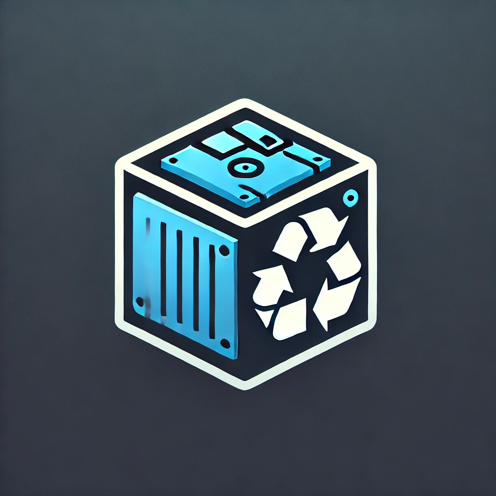

# Docker Volume Dump Backup & Restore (DVDBR) v2.2.0

<p align="left">
  
</p>

[](https://opensource.org/licenses/MIT)
[](https://www.gnu.org/software/bash/)
[](https://www.docker.com/)

**DVDBR** is an enterprise-grade, lightweight Bash utility designed to backup and restore Docker volumes safely. It handles container lifecycle management, zero-downtime atomic streaming, multi-threaded **Zstandard (`zstd`) compression**, optional **GPG symmetric encryption (AES-256)**, local archiving, and multi-vector remote transfers (SSH stream, `rsync`, `scp`) with disk space monitoring.

---

## 🚀 Key Features & Architectural Improvements in v2.2.0

- **Multi-threaded Zstandard Compression (`zstd`):** Replaced legacy `gzip` with `zstd -T0 -10` inside Alpine. Delivers ultra-fast multi-core compression, reduced downtime during container stops, and higher compression ratios (`.tar.zst`).
- **Symmetric GPG Encryption (AES-256):** Option to encrypt archives on the fly (`-e` / `--encrypt`). Protects backup files locally and remotely (`.tar.zst.gpg`).
- **Selectable Remote Protocols & Atomic Streaming:**
  - **Direct SSH Stream (`stream`):** Zero-disk overhead pipe (`docker run | gpg | ssh cat`). Atomic write on remote host (`cat > file.tmp && mv`) prevents corrupted files on network disconnects.
  - **Staging Rsync (`rsync`):** Writes temporary staging archive locally, transfers via `rsync` with resume and checksum validation.
  - **Staging SCP (`scp`):** Legacy fallback mechanism.
- **Disk Space Pre-Flight Check:** Displays available disk space in real-time for both local backup paths and staging directories (`df -h` parsing).
- **Custom Staging Path Control (`--stage-dir`):** Avoids `/tmp` memory-filling issues (e.g., `tmpfs`) or small `/` partitions by letting you specify custom staging paths (e.g., `/var/tmp` or a mounted storage volume).
- **Dual Operating Modes:**
  - **Interactive TUI:** Menu-driven interface with encryption prompts and space insights.
  - **Non-Interactive CLI Flags:** Fully automated mode for `cron`, `systemd.timer`, or CI/CD pipelines.
- **Fail-Safe Signal Trapping (`trap`):** Captures `EXIT`, `SIGINT`, and `SIGTERM`. If interrupted (`Ctrl+C`), **only the containers stopped by DVDBR are safely restarted**.
- **Universal Restore Engine:** Restores `.tar.zst`, `.tar.gz`, and `.gpg` encrypted archives cleanly into target Docker volumes.

---

## 📊 Architecture & Execution Flow

```text
                        ┌──────────────────────────────┐
                        │       DVDBR Invocation       │
                        └──────────────┬───────────────┘
                                       │
                        ┌──────────────▼───────────────┐
                        │ Signal Trap Handler Setup    │
                        │   (Guarantees auto-cleanup)  │
                        └──────────────┬───────────────┘
                                       │
                        ┌──────────────▼───────────────┘
                        │ Check Docker Privileges      │
                        │   (Direct or Sudo escalation)│
                        └──────────────┬───────────────┘
                                       │
                       /───────────────────────────────\
                      /   CLI Parameters Provided?      \
                      \_________________________________/
                               /               \
                        Yes   /                 \ No
                             /                   \
        ┌───────────────────▼──┐               ┌──▼──────────────────┐
        │ Non-Interactive Mode │               │ Interactive Menu    │
        │    (CLI Flags)       │               │ (TUI + Encryption)  │
        └─────────┬────────────┘               └──┬──────────────────┘
                  │                               │
                  └────────────────┬──────────────┘
                                   │
                      /─────────────────────────\
                     /    Execution Mode?        \
                     \___________________________/
                              /           \
                     Backup  /             \ Restore
     ┌─────────────────────▼──────┐   ┌──────▼─────────────────────┐
     │ Inspect Volumes & Detect   │   │ Validate Source Archive    │
     │ Bound Active Containers    │   │ & Ensure Target Volume     │
     └─────────────┬──────────────┘   └──────┬─────────────────────┘
                   │                         │
     ┌─────────────▼──────────────┐   ┌──────▼─────────────────────┐
     │ Graceful Shutdown          │   │ Graceful Shutdown          │
     │ (Stop impacted containers) │   │ (Stop impacted containers) │
     └─────────────┬──────────────┘   └──────┬─────────────────────┘
                   │                         │
     ┌─────────────▼──────────────┐   ┌──────▼─────────────────────┐
     │ Execute Alpine zstd Dump   │   │ Execute Extraction Engine  │
     │  - Optional GPG (AES256)   │   │ (Decrypt GPG if needed,    │
     │  - Local (.tar.zst[.gpg])  │   │  wipe target & zstd -d)    │
     │  - Atomic SSH Stream       │   └──────┬─────────────────────┘
     │  - Staging Rsync/SCP       │          │
     └─────────────┬──────────────┘          │
                   │                         │
                   └────────────────┬────────┘
                                    │
                       ┌────────────▼─────────────┐
                       │ Execute Trap Handler     │
                       │ (Restart stopped stack)  │
                       └────────────┬─────────────┘
                                    │
                       ┌────────────▼─────────────┐
                       │ Clean Exit               │
                       └──────────────────────────┘
```

---

## 🔧 Prerequisites

- **Host OS:** Linux (Debian, Ubuntu, RHEL, Arch Linux, CachyOS, etc.)
- **Dependencies:** `bash`, `docker`, `tar`
- **Optional (for encryption / remote backup):** `gpg`, `openssh-client`, `rsync`, `scp`

---

## ⚡ Quick Start & Usage

### 1. Installation

```bash
curl -sSL https://raw.githubusercontent.com/RipleyBooya/DVDBR/main/DVDBR.sh -o DVDBR.sh
chmod +x DVDBR.sh
```

### 2. Interactive Mode (TUI)

Simply execute the script without arguments to start the interactive wizard:

```bash
./DVDBR.sh
```

### 3. Non-Interactive CLI Mode (Automation / Cron)

#### Backup Examples

- **Local zstd Backup with Symmetric GPG Encryption:**
  ```bash
  ./DVDBR.sh -b -v nextcloud_data -l /var/backups/docker -e --passphrase "MyPassphrase123" -y
  ```

- **Remote SSH Backup via Atomic zstd Stream (Encrypted):**
  ```bash
  ./DVDBR.sh -b -a -s backupuser@nas.local:/volume1/docker_backups -p stream -e --passphrase "MyPassphrase123" -i ~/.ssh/id_ed25519 -y
  ```

- **Remote SSH Backup via Staging Rsync with Custom Staging Path:**
  ```bash
  ./DVDBR.sh -b -v db_data -s user@remote:/backups -p rsync --stage-dir /var/tmp -y
  ```

#### Restore Example

- **Restore encrypted `.tar.zst.gpg` archive to a target volume:**
  ```bash
  ./DVDBR.sh -r -f ./backups/nextcloud_data_20260330_120000.tar.zst.gpg -t nextcloud_data --passphrase "MyPassphrase123" -y
  ```

---

## ⚙️ CLI Flags Reference

| Flag | Long Option | Description |
| :--- | :--- | :--- |
| `-b` | `--backup` | Run in Backup mode |
| `-r` | `--restore` | Run in Restore mode |
| `-v` | `--volume NAME` | Target Docker volume name (can be repeated) |
| `-a` | `--all-volumes` | Select all existing Docker volumes for backup |
| `-l` | `--local-dir PATH` | Enable local backup and specify target directory |
| `-s` | `--remote TARGET` | Enable remote backup (`user@host:/path`) |
| `-p` | `--proto PROTO` | Remote transfer protocol: `stream` (default), `rsync`, `scp` |
| `--stage-dir` | `PATH` | Custom staging folder for `rsync`/`scp` (Default: `/tmp`) |
| `-e` | `--encrypt` | Enable GPG symmetric encryption (AES-256) |
| `--passphrase`| `PASS` | Encryption/decryption passphrase (can also set `PASSPHRASE` env var) |
| `-i` | `--identity PATH` | Custom SSH private key path (Default: `~/.ssh/id_rsa`) |
| `-f` | `--file PATH` | Backup file path (`.tar.zst`, `.tar.gz`, `.gpg`) for restoration |
| `-t` | `--target-vol NAME`| Target volume name for restoration |
| `-n` | `--no-stop` | Do not stop containers during operation |
| `-y` | `--non-interactive`| Disable prompts (required for automation) |
| `--no-timestamp` | | Exclude timestamp suffix from generated backup filename |
| `-h` | `--help` | Show usage documentation |

---

## 📝 TODO / Roadmap

- [ ] **Asymmetric Encryption Support (`age` / GPG public-key):**
  - Implement asymmetric public key encryption (`age -r` or `gpg -e -r`) so source Docker hosts can encrypt backups without holding the decryption private key.
- [ ] **Retention & Automated Pruning (`--retention-days N`):**
  - Add optional automatic cleanup of remote/local backups older than $N$ days via SSH `find` / local purge.
- [ ] **Webhook Notifications:**
  - Add native HTTP ping notifications (Healthchecks.io / Uptime Kuma / Discord webhooks) on successful or failed backup runs.

---

## 🛡️ License

Distributed under the **MIT License**. See `LICENSE` for more information.

---

## 🤖 AI Assistance & Acknowledgment

This project was developed with assistance from an AI-powered assistant, ensuring efficiency and optimization while maintaining human oversight.

---

## 🔗 Project Links

- **GitHub Repository:** [RipleyBooya/DVDBR](https://github.com/RipleyBooya/DVDBR)
- **ForgeJo Mirror:** [Ripley/DVDBR](https://forge.tail403cd.ts.net/Ripley/DVDBR)
